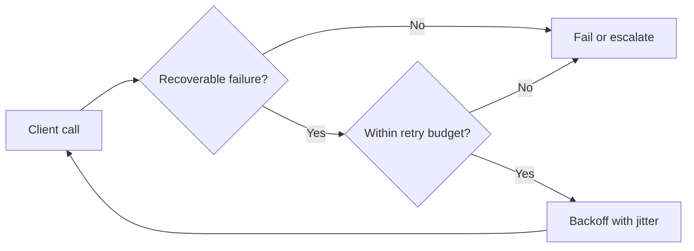
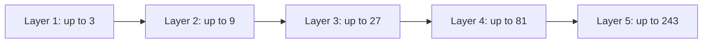

# Technical Article Editorial Master Playbook v1.0

This single file combines the operating guide, editorial standard, reusable templates, prompts, review protocol, worked example, and source pattern notes. For an editable multi-file workflow, use the accompanying ZIP. Claim register CSV templates are in the ZIP.

---

<!-- BEGIN 00_START_HERE.md -->

# Technical Article Editorial Kit — v1.0

**Purpose:** Turn a topic into an original, evidence-grounded, technically substantial Medium article. Adapted from analysis of Anthropic Engineering posts; **not** an Anthropic template, endorsement, or reproduction of its wording.

**Editorial promise:** Every article should help an experienced reader understand a mechanism, recognize a meaningful trade-off, or make a better technical decision. Breadth supplies context; depth explains mechanisms; height produces judgment. Evidence makes the argument defensible. Figures make the reasoning visible.

## What is in this kit?

| File | When to use it | Output / decision |
|---|---|---|
| `01_EDITORIAL_STANDARD.md` | Before every new article or when reviewing one | Shared quality bar, article archetypes, writing principles |
| `02_ARTICLE_BRIEF_TEMPLATE.md` | Stage 1: plan the article | Approved one-page-to-two-page editorial brief |
| `03_EVIDENCE_GUIDE.md` + `03_CLAIM_REGISTER.csv` | Stage 2: research and source validation | Traceable claims, contradictory evidence and gaps |
| `04_VISUAL_STORYBOARD_TEMPLATE.md` | Stage 3: diagram planning | Figure specifications tied to reader questions |
| `05_PROMPT_LIBRARY.md` | To run each stage in ChatGPT or another writing assistant | Independent prompts for researcher, drafter, reviewer, editor |
| `06_EDITORIAL_REVIEW.md` | Before any draft is accepted for publication | Blocking defects, severity-ranked revisions, sign-off |
| `07_WORKED_EXAMPLE_RETRIES.md` | See how the system works on a non-AI topic | Filled brief + sample evidence/figures; **not** an article |
| `08_SOURCE_PATTERN_NOTES.md` | Revisit source-inspired techniques | Auditable editorial observations and original links |

## Minimal operating sequence

1. **Frame:** Fill `02_ARTICLE_BRIEF_TEMPLATE.md`. State one falsifiable or at least challengeable thesis, target audience, one genuine engineering tension, scope boundary, expected takeaway, and article archetype.
2. **Research:** Complete the relevant rows in `03_CLAIM_REGISTER.csv`. Resolve claims that would affect the article's recommendation; preserve dissenting findings and version assumptions.
3. **Storyboard:** Complete `04_VISUAL_STORYBOARD_TEMPLATE.md` for the figures actually needed. Draft figure logic **before** writing detailed technical sections. A text-only article is acceptable if figures would not help.
4. **Draft:** Use the drafting prompt in `05_PROMPT_LIBRARY.md`, passing the actual brief, source register and storyboard. The body must advance an engineering argument, not mechanically follow a generic benefits/use-cases template.
5. **Review:** Use `06_EDITORIAL_REVIEW.md` in an independent pass. Report factual and conceptual defects before copyediting. Provide precise replacements for significant issues. Iterate until all release blockers are resolved.
6. **Publish:** Verify the final title, sources, captions, image rights, mobile figure legibility, Medium formatting, and any time-sensitive facts.

## Stage gates and handoffs

| Gate | Must be true to proceed |
|---|---|
| G1 — Brief accepted | One thesis; audience; reader transformation; problem/tension; scope; and section-to-argument map |
| G2 — Evidence ready | Critical claims sourced or marked clearly as hypotheses; important disagreements addressed; no invented tests, metrics or firsthand experience |
| G3 — Visual architecture ready | Every proposed figure has one explanatory job, underlying facts and a caption/alt-text plan |
| G4 — Draft ready to review | Technical mechanism is present, sections progress causally, examples are identified as measured or illustrative, source citations are attached |
| G5 — Publication ready | No blocking defects in `06_EDITORIAL_REVIEW.md`; final sources, visuals, headline and copy verified |

**If a gate fails:** Return to the earliest affected artifact. Do not fill a source or experimental gap with fluent prose. When evidence is unavailable, narrow the claim, add a clear qualification, design a reproducible experiment, or omit the claim.

## Quick start for a new chat

Attach `01` through `06` and say:

> Apply this editorial kit to **[TOPIC]** for **[AUDIENCE]**. Start with an evidence-backed editorial brief, not a complete article. Challenge the thesis, choose an appropriate article archetype, map breadth/depth/height, identify sources and uncertainties, and propose a minimal figure storyboard. Stop at Gate G1 and tell me what remains unverified for Gate G2.

When advancing stages, pass the **actual latest version** of the previous artifacts. Do not assume an assistant still has the same source materials from another conversation.

## Versioning and change discipline

At the top of every active article brief, record `Article ID`, `Version`, `Date`, `Status`, and `Source snapshot date`. Preserve decisions and unresolved issues in the brief. When updating, state what changed and why. Changes to the thesis require revisiting evidence, section structure and diagrams.

## Source-derived inspiration

Three primary readings:
- [Anthropic Engineering — Claude Code auto mode](https://www.anthropic.com/engineering/claude-code-auto-mode)
- [Anthropic Engineering — Demystifying evals for AI agents](https://www.anthropic.com/engineering/demystifying-evals-for-ai-agents)
- [Anthropic Engineering — Harness design for long-running applications](https://www.anthropic.com/engineering/harness-design-long-running-apps)

Use these to study editorial craft, not as universal evidence for an unrelated technical claim. The article's own subject requires its own sources.


<!-- END 00_START_HERE.md -->

---

<!-- BEGIN 01_EDITORIAL_STANDARD.md -->

# Editorial Standard — Engineering Articles v1.0

**Applies to:** Technical articles on AI, software engineering, systems, protocols, security, data, platforms, infrastructure, architecture and research. Intended default readership: experienced technical practitioners; adjust terminology and depth to the stated audience.

## 1. Publication contract

Our article should do at least one of the following exceptionally well:

- Make a mechanism intelligible that existing summaries obscure.
- Test or challenge an attractive but incomplete engineering assumption.
- Expose a consequential architectural trade-off with evidence.
- Turn a real implementation or experiment into transferable lessons.
- Synthesize conflicting primary sources into a more useful decision model.

**Not sufficient:** an exhaustive list of definitions, a collection of vendor features, a parade of diagrams without analysis, or a polished restatement of introductory documentation.

**Reader transformation:** Write one sentence describing what readers can explain, diagnose or decide after reading that they could not before. If that sentence is weak, the article is not framed yet.

## 2. Three-dimensional technical coverage

### Breadth = necessary context

Show the competing approaches, relevant history, architectural surroundings and boundary conditions **needed to interpret the central argument**. Breadth is *selectivity*, not number of topics. Ask: which alternative would a skilled reader reasonably consider? What adjacent system changes the recommendation?

### Depth = mechanism and causality

Explain how key components, algorithms, decisions and failure paths work. Prefer a causal chain: *condition → internal behavior → observed outcome → design consequence*. Use pseudocode, request traces, small calculations and system diagrams when they clarify. Avoid code without a teaching purpose.

### Height = consequence and judgment

Derive when the method is useful, where it fails, the cost of using it, and how a team might choose among alternatives. State assumptions on workload, scale, trust boundary, cost, latency, operating environment or versions as appropriate. Height is not executive buzzword abstraction.

**Balance test:** Can the reader locate context, inspect the mechanism, and defend a decision? If any answer is no, the article is incomplete.

## 3. Argument spine (conceptual, not mandatory headings)

1. **Problem:** A concrete difficulty, confusion, surprising observation or engineering need.
2. **Tension:** Why the familiar or obvious approach is insufficient under particular conditions.
3. **Mechanism:** The system or technique, explained with its necessary internal detail.
4. **Evidence:** Reproducible example, primary source, experiment, source code, trace, or qualified observation.
5. **Trade-off:** What it improves, what it costs, what remains unsolved; compare with a viable alternative.
6. **Judgment:** Applicability boundary, diagnostic question, migration path or decision criterion.

Sections need not appear in this exact order. They must have a reason to exist and create a reason to read the next one.

## 4. Choose one dominant article archetype

| Archetype | When appropriate | Natural progression | Common failure |
|---|---|---|---|
| Mechanism explainer | Understanding an unfamiliar algorithm, system or technique | Misconception → mental model → internal mechanics → worked example → implications | Definitions with little causal insight |
| Engineering investigation | We have design iterations, implementation experience, measured or observed behavior | Failure/constraint → hypothesis → alternatives → build/test → observations → limitations | Retrofitting a success story and hiding failed trials |
| Research synthesis | Sources disagree, newer evidence changes existing assumptions | Question → literature → comparison of methods → agreement/disagreement → implications | Mistaking paper abstracts for validated facts |
| Architecture decision | Teams need to choose between approaches | Requirements → alternatives → decisive trade-offs → failure modes → choice conditions | Announcing a recommendation before stating constraints |

For some subjects, hybridization is appropriate. Explicitly identify the *dominant* approach to prevent meandering.

## 5. Research, uncertainty and claim ethics

**Evidence hierarchy is context-dependent.** Specifications govern protocol semantics; implementation source governs a specific release; papers support their measured findings and stated assumptions; public engineering blogs report authors' experiences; production results require actual operational evidence. No single type of source is universally superior.

For consequential claims, track:
- What exactly is being claimed? Is it a definition, fact, first-hand observation, reported observation, hypothesis or interpretation?
- Which primary source supports it? Which section or code line? When and for which version?
- What was measured, on what population/sample, with which baseline and controls?
- What contradictory evidence or boundary case exists?
- What is **not** known?

Do **not** invent tests, log output, quotations, usage numbers, datasets, citations or first-person deployment experience. If a synthetic numerical example is useful, label it *illustrative* and show the assumptions. If discussing reported vendor metrics, attribute the owner and setup. Do not turn a single anecdote into a general law.

Keep published dates and version anchors where currency matters. Before final publication, revisit stale claims and URLs. A current API description cannot be assumed valid for an older SDK/version.

## 6. Explanatory paragraphs that earn their space

Prefer this reasoning structure, used flexibly rather than formulaically:

**Claim or observation → mechanism → concrete evidence/example → implication or limitation.**

Weak: “Retries increase resilience. Teams should use exponential backoff.”

Stronger illustrative paragraph: “Retries are useful when a dependency's failure is transient, but they become extra workload when the dependency is saturated. If clients retry immediately, a small failure rate can amplify incoming traffic precisely when the service has less spare capacity. Backoff with jitter spreads attempts over time; retry limits bound additional work. Neither technique by itself makes a non-idempotent operation safe to repeat.”

Do not force four sentences into every paragraph; vary rhythm. Paragraphs should connect, not become isolated slogan lines.

## 7. Visual reasoning policy

Begin visual planning before drafting the mechanism-heavy prose. Only include a figure when it addresses a genuine reader question better than text alone.

Each visual must specify:
- **Question:** what confusion is this figure resolving?
- **Kind:** conceptual model, comparison, architecture, sequence, data flow, failure path, experiment/chart, or decision boundary.
- **Correctness:** nodes, arrows, ordering, boundaries, invariants and exclusions all checked.
- **Source:** original or adapted, with attribution and permission/license requirements checked.
- **Caption:** conclusion or interpretive lens, not “This figure shows the architecture.”
- **Accessibility:** legible at narrow Medium widths; clear labels, alt text, no color-only meaning.

**Do not assert:** a model is actual implementation code when it is merely conceptual; a simulated result is production telemetry; a re-created figure is sourced from a paper without attribution.

## 8. Voice and editorial craft

The tone should be technically confident but calibrated. Prefer concrete verbs, precise nouns and clear transitions. Use first person for genuine author choices or firsthand work only. Use terms of art where they improve accuracy; explain unfamiliar terms at their first consequential appearance.

Avoid:
- Generic opening (“In today's rapidly evolving world…”).
- Empty adjectives (“revolutionary,” “game-changing,” “cutting-edge”) without measurable support.
- Invented authority (“we observed in production”) unless supplied by the author.
- Fake tension, e.g. framing mundane configuration as a dramatic breakthrough.
- Repeated explanations restated in the introduction, each section and conclusion.
- Mechanical sequencing (“Let's dive in”, “It's important to note”, “Here are 10 benefits”).
- Overloaded diagrams, reference dump paragraphs, excessive one-line paragraphs.
- Promotional certainty that exceeds the experiment, source or architecture constraints.

Originality comes from framing, independent synthesis and accountable interpretation—not merely novel adjectives.

## 9. A strong beginning, middle and ending

**Opening (usually 2–5 paragraphs):** establish the problem, stakes, a non-obvious tension and the reader's destination. An anecdote is optional; a precise problem is essential. A striking number requires an attributable source.

**Middle:** deliver the core mechanism, evidence and critical alternatives. Use examples and visualizations near the exact claims they support. Maintain logical handoffs: *why this section matters* should be apparent.

**Ending:** synthesize a decision model, transferable lesson, or unresolved question. Do not merely repeat headings or add a generic call to action.

## 10. Code and worked examples

Code is optional and earns its presence by explaining important control flow, data structure, invariants or failure cases. Prefer the smallest excerpt that proves the point. For runnable examples, document environment and version, distinguish tested from illustrative, and keep code in an accessible repository or appendix if lengthy. Never claim a sample was executed unless verified.

For equations: state variables, assumptions and interpretation. A mathematically true formula can still mislead if it uses unrealistic independence assumptions.

## 11. Medium publishing layer

Optimize for thoughtful reading and mobile display: descriptive headings, restrained boldface, informative figure captions and integrated source links. Set length based on the argument and its audience, not an artificial minutes-read target. Create a defensible title first, then refine for search intent without exaggeration. Use a short subtitle to state the distinct insight, not to repeat the title.

Before publication, check image rights, alt text, diagram widths, hyperlinks, code formatting, citations, authorial attribution, and changes in version-specific claims.

## 12. Non-negotiable publication blockers

1. Materially false mechanism or misleading diagram.
2. Fabricated metric, experiment, citation, quotation or author experience.
3. Core conclusion unsupported by the available evidence.
4. Critical alternative or material counterexample omitted in a way that reverses the recommendation.
5. Reproduced third-party text or figures without appropriate attribution and rights.
6. Sensitive/private/internal information published without authorization.

**Editorial release principle:** Style and readability do not offset any blocker. Fix the earliest broken stage, update dependent artifacts and review again.


<!-- END 01_EDITORIAL_STANDARD.md -->

---

<!-- BEGIN 02_ARTICLE_BRIEF_TEMPLATE.md -->

# Article Brief — Fillable Template

> **Instruction:** Duplicate this file for every article. Fill with actual evidence, not presumed facts. This is the approval artifact for Gate G1, not the article itself. Aim for 1–2 pages of *substantive* planning; expand only when useful.

## Document control

- Article ID: `ART-YYYY-NNN`
- Topic / working title:
- Version / updated date:
- Status: `IDEA | RESEARCHING | BRIEF-READY | APPROVED | DRAFTING | REVIEW | RELEASED`
- Source snapshot date (YYYY-MM-DD):
- Intended publisher/channel: Medium
- Author / technical reviewer:

## A. Core editorial decision

**Reader:** [Who? Knowledge level? What do they already understand?]

**Reader transformation:** After reading, the reader can [explain / diagnose / implement / compare / decide] ________.

**One central engineering question:** ________?

**Proposed thesis — one defensible sentence:** ________.

**Why this thesis matters now / under these conditions:** ________.

**Strongest plausible counterargument:** ________.

**What evidence might cause us to revise the thesis?** ________.

**Dominant archetype:** `Mechanism explainer | Engineering investigation | Research synthesis | Architecture decision`.

**Unique contribution:** [What do we contribute beyond existing top sources? New comparison, carefully worked mental model, new experiment, cross-source synthesis, counterexample, code inspection?]

## B. Scope and constraints

**In scope:**
- ...

**Out of scope (and why):**
- ...

**System / API / SDK / paper version assumptions:** ________.

**Audience assumptions:** ________.

**Limitations already known:** ________.

**What would be misleading to generalize?** ________.

## C. Breadth → Depth → Height map

| Dimension | Specific questions to answer | Planned evidence/sections |
|---|---|---|
| Breadth: context and alternatives | ... | ... |
| Depth: mechanism and failure path | ... | ... |
| Height: operating and design consequences | ... | ... |

## D. Argument spine (reader questions, not generic headings)

| Role | Reader question / insight | Evidence needed | Provisional section |
|---|---|---|---|
| Problem | ... | ... | ... |
| Tension | ... | ... | ... |
| Mechanism | ... | ... | ... |
| Evidence | ... | ... | ... |
| Trade-off | ... | ... | ... |
| Judgment | ... | ... | ... |

Remove rows that do not make sense for the chosen archetype; include additional rows if necessary. The final article should **not** automatically use these role labels as headings.

## E. Sources and verification plan

- Primary spec / official documentation:
- Original research or reference implementation:
- Credible engineering reports / field evidence:
- Counter-perspective or negative evidence:
- Version/currency checks required:
- Claims needing an original experiment:
- Unresolved critical claims / source gaps:
- Link to or location of `03_CLAIM_REGISTER.csv`:

## F. Worked example / experiment design

- Example question or hypothesis:
- Is it `illustrative`, `reported by source`, `reproduced`, or `our measured result`?
- Inputs / environment / versions:
- Control or baseline, if making a comparison:
- Measurement/observation method:
- Expected explanatory value:
- Threats to validity / caveats:

## G. Visual storyboard preview

| Figure ID | Reader question | Figure type | Source of facts | Where it fits |
|---|---|---|---|---|
| F1 | ... | ... | ... | ... |
| F2 | ... | ... | ... | ... |

Complete the detailed figure specifications in `04_VISUAL_STORYBOARD_TEMPLATE.md`. **No fixed minimum figure count.**

## H. Publication intent

- Working headline (accurate, searchable, not exaggerated):
- Proposed subtitle (promises a distinctive insight):
- Planned take-home judgment in 1–2 sentences:
- Expected reading depth: `Focused | Standard | Deep dive` (do not choose word count before knowing the argument)
- Key terms readers may search for (natural usage only):

## I. G1 sign-off

- [ ] Thesis is specific and challengeable.
- [ ] Reader, original contribution and scope are explicit.
- [ ] A real problem/tension drives the narrative.
- [ ] Breadth, depth and height have concrete roles.
- [ ] Strong counterargument identified.
- [ ] Evidence gaps and uncertainties are visible.
- [ ] Figure ideas answer questions, not merely decorate.

**Decision:** `APPROVED | REVISE | HOLD`  
**Reason / required changes:** ________.


<!-- END 02_ARTICLE_BRIEF_TEMPLATE.md -->

---

<!-- BEGIN 03_EVIDENCE_GUIDE.md -->

# Research and Claim Evidence — Operating Guide

Use this alongside `03_CLAIM_REGISTER_TEMPLATE.csv`. Copy the CSV into an article workspace, rename it `ART-YYYY-NNN_claims.csv`, and populate a row for **each material claim**. A material claim is one that influences the thesis, the mechanism, a visual, an important numerical assertion, a comparison, or the recommendation. Minor connective prose does not need a row.

## Claim taxonomy

| Type | Meaning | Required language |
|---|---|---|
| `SPEC` | Normative requirement or defined semantics from a standard/specification | Anchor to the exact section and applicable version |
| `IMPLEMENTATION` | Observable behavior in a specific implementation/release | Name component, repository and version/commit if known |
| `RESEARCH` | Finding from a paper or controlled study | Give population/task, experimental setting, methodology and key limits |
| `REPORTED` | Engineering finding reported by another team/company | Attribute to source and describe scope; do not present as independently validated |
| `FIRSTHAND` | Author's direct test, code reading or operational observation | Include reproducer, test setup, date, raw logs/results where publishable |
| `ILLUSTRATIVE` | Invented but logically coherent example for teaching | Label illustrative; no claims of field measurement |
| `INFERENCE` | Our interpretation that joins facts into a conclusion | State premises, reasoning and uncertainties |
| `HYPOTHESIS` | Plausible but unverified candidate explanation | Use tentative language and define a test; do not state as fact |

## Mandatory fields for material claims

`claim_id`, `draft_claim`, `claim_type`, `source_title`, `source_url_or_artifact`, `source_anchor`, `version_or_population`, `method_or_conditions`, `limitation_or_counterevidence`, `verification_status`, `used_in_section_or_figure`.

Other fields help track origin, publication date and editorial edits. Never write “verified” merely because a web page exists. Verify that the **specific** source statement supports the **specific** claim.

Suggested verification statuses: `TO_CHECK`, `SUPPORTED`, `QUALIFY`, `CONFLICTED`, `UNSUPPORTED`, `EXCLUDED`.

## Source selection and triangulation

1. **Start with authoritative ownership.** For semantics, use a specification. For current product behavior, use official versioned docs/source. For effectiveness claims, use empirical studies or transparent field investigations.
2. **Read more than summaries.** Locate the decisive definition, figures, experimental setup, tables, caveats and counterclaims. Avoid using a search-result snippet as the entire evidence base.
3. **Inspect conflicts.** Why do sources disagree? Different versions, populations, definitions, test harnesses, baselines, incentives, or measurement periods?
4. **Check the time axis.** Record source publication/access date and applicable version. Current rules and API behavior may have changed.
5. **Separate the kinds of evidence.** Code inspection confirms current implementation branches, not fleet-wide failure rates. A vendor blog explains its reported case, not all deployments. A synthetic example clarifies logic, not empirical effectiveness.
6. **Use counterevidence deliberately.** An alternative approach can be the right choice under different constraints. Report those conditions instead of arguing for one universal winner.

## Claim escalation policy

- **SUPPORTED:** use a precise claim, cite the source, preserve conditions.
- **QUALIFY:** narrow language until it matches support; remove extrapolation.
- **CONFLICTED:** present disagreement and its plausible causes; no definitive recommendation without a way to resolve it.
- **UNSUPPORTED:** perform an experiment, find a stronger source, mark as hypothesis, or remove it.
- **High-impact result or metric:** check denominator, sample, baseline, methodology, confidence/variability when available, and applicability. Do not invent missing statistical uncertainty.
- **Security/safety guidance:** prioritize the exact threat model and boundary conditions; avoid implying that a mechanism guarantees safety.

## Research deliverable at G2

Produce a 1-page **Evidence Synthesis** with:

1. What is established and why.
2. What source authors report (and under what conditions).
3. What is disputed or uncertain.
4. Which original figure/example/experiment can clarify it.
5. Which claims should be narrowed or excluded.
6. Which citation sources must appear in the published article.

An evidence register is a working control, not a demand to cite every sentence in Medium. Cite close to the claims that require verification, and include links to the most authoritative originals.

## Source reuse, permissions and confidentiality

Paraphrase with proper attribution; do not reproduce extended source passages. Visuals from papers/vendor posts can require explicit licensing or permission. A recreated diagram closely following a source still needs attribution and rights review. Do not use internal project names, customer data, private telemetry or proprietary screenshots without approval. When firsthand access is unavailable, describe a reproducible public demonstration instead.


<!-- END 03_EVIDENCE_GUIDE.md -->

---

<!-- BEGIN 04_VISUAL_STORYBOARD_TEMPLATE.md -->

# Visual Storyboard — Fillable Template

**Instruction:** Duplicate for each article. A good figure must do explanatory work. Decide what the reader needs to understand **before** deciding whether to draw boxes, arrows, a chart or a timeline.

- Article ID / version:
- Core thesis:
- Intended reader:
- Medium display constraints: narrow mobile width; clear labels and readable caption.

## Figure inventory

| Figure | Reader question resolved | Explanatory purpose | Figure type | Related claim IDs | Editorial status |
|---|---|---|---|---|---|
| F1 | ... | ... | ... | ... | `IDEA` |
| F2 | ... | ... | ... | ... | `IDEA` |

No predetermined figure quota. Remove any proposed figure that adds no understanding.

## Figure F1 — Specification (copy this block for each figure)

**Working name:** ________

**Placement:** [After which claim, before which complex explanation?]

**Reader question:** ________?

**One-sentence insight:** After viewing, the reader should understand that ________.

**Figure type:** `Conceptual model | Architecture | Sequence | Data flow | Failure path | Comparison | Experiment/chart | Decision flow`

**Representation choice and rationale:** [Why this form rather than prose or a table?]

**Required entities / variables:**
- ...

**Required relationships, direction, order or formula:**
- ...

**Boundaries and assumptions:**
- ...

**Facts driving this visual:** [Claim IDs + sources + applicable versions]

**Exclude:** [Decorative symbols, unsupported metrics, irrelevant subsystems, false implication of exactness]

**Draft figure source:** [Mermaid / SVG source file / code / original drawing file / clear description]

**Proposed caption:** [Say what the figure establishes, including an important caveat if necessary.]

**Proposed alt text:** [Describe the meaningful relationships for a screen reader; do not just repeat the title.]

**Source/rights:** `Original | Adapted with attribution | Licensed third-party`; record URL and permission status where relevant.

**Verification checklist:**
- [ ] Every arrow means something defined; no misleading direction or sequencing.
- [ ] Terms and components match the actual implementation/model/version.
- [ ] Numerical plots represent measured or clearly labeled synthetic data, with appropriate axes/units/baselines.
- [ ] Caption communicates the insight and limitations.
- [ ] The figure is readable on a phone; no microscopic text or overloaded boxes.
- [ ] Information is not encoded by color alone; alt text provided.
- [ ] Source and permissions are resolved.

**Decision:** `KEEP | REVISE | CUT` — reason: ________

## Figure design heuristics

- **Before code:** a conceptual/architecture figure can orient a reader, but do not add one if code itself is the simplest explanation.
- **Mechanisms:** sequence/data-flow diagrams should show exactly where inputs move, state changes, boundaries are crossed and errors appear.
- **Trade-offs:** a comparison chart should name real axes and avoid invented precision. If the relationship cannot be quantified, use labeled qualitative regions with explicit assumptions.
- **Experimental evidence:** include methods or environment in the caption or adjacent text; show baselines and uncertainty where available; do not cherry-pick one outcome.
- **Complex figures:** split by questions, not by arbitrary node count. Prefer one main visual per causal step over a huge diagram meant to cover the entire article.

## Figure-to-prose integration check

For each figure, the paragraph **before** should establish why the question matters. The paragraph **after** should extract the conclusion or introduce the edge case. Avoid “Figure 2 illustrates the architecture” as the entire explanation.

## Optional Mermaid scratch example (illustrative only)



This is only a decision *sketch*, not a correct universal retry implementation; a real design also needs idempotency, deadline, overload signals and per-layer policy. Never reuse the sketch without checking the actual article's scope.


<!-- END 04_VISUAL_STORYBOARD_TEMPLATE.md -->

---

<!-- BEGIN 05_PROMPT_LIBRARY.md -->

# Reusable Editorial Prompts — v1.0

These prompts operationalize the accompanying playbook. Use the **actual artifacts** from the current article as inputs. The prompts are deliberately stage-specific: this prevents research, writing and review from collapsing into a single plausible but unchecked response.

## Prompt 0 — Kick off a new topic (most useful entry point)

```text
Act as a technically rigorous author, researcher, and skeptical engineering editor for a Medium article.

Apply the attached Editorial Kit v1.0, especially 01_EDITORIAL_STANDARD.md,
02_ARTICLE_BRIEF_TEMPLATE.md, 03_EVIDENCE_GUIDE.md, and
04_VISUAL_STORYBOARD_TEMPLATE.md. Do not imitate the text or voice of Anthropic;
learn from its engineering reasoning, specificity, evidentiary candor and visual clarity.

TOPIC: [INSERT]
AUDIENCE: [INSERT OR INFER AND STATE]
KEY QUESTION / PERSONAL ANGLE: [INSERT IF AVAILABLE]
CONSTRAINTS / PROVIDED ARTIFACTS: [INSERT]

First research authoritative current materials appropriate for this topic. Read
original documentation/specifications, papers or engineering sources, not just
search snippets. Confirm dates/versions for material claims. Do not fabricate
results or imply firsthand experiments that were not performed.

Return only:
1. Editorial recommendation: strongest technical question, defensible thesis,
   strongest counterargument and our distinctive contribution.
2. A completed 02_ARTICLE_BRIEF_TEMPLATE, with concrete breadth, depth and height.
3. A provisional source/evidence map, distinguishing verified facts, external
   reports, inferences, hypotheses and open gaps.
4. A minimal figure storyboard with what each visual would prove/explain.
5. Gate G1 decision and issues blocking G2.

Do not draft the article yet. Challenge weak premises rather than agree with me.
```

## Prompt 1 — Research and evidence synthesis

```text
You are the research editor. Use the APPROVED brief below and the Editorial Kit.
Research the central thesis and strongest competing explanation using primary
sources whenever possible. Treat sources as evidence with scope and limitations,
not as content to paraphrase mechanically.

INPUTS:
[APPROVED ARTICLE BRIEF]
[AVAILABLE DOCUMENTS / SOURCES]

Produce:
A. Research synthesis: established facts, evidence authors report, important
   disagreements, limits and which parts require original testing.
B. A populated claim register conforming to 03_CLAIM_REGISTER_TEMPLATE.csv.
   For every consequential claim give a direct URL/artifact, exact section or
   anchor, version/date, scope and status.
C. Three to five decisive claims and the strongest possible objection to each.
D. Recommendation on what to cut, narrow or qualify.
E. Gate G2 decision with explicit blockers.

Do not invent citations, experiments, statistical significance or production
experience. If browsing or source access fails, disclose the gap. Do not mark a
claim VERIFIED merely because a page exists.
```

## Prompt 2 — Narrative architecture and diagram specification

```text
You are the structural editor and technical illustrator.
Use the accepted brief and evidence register. The aim is to make the engineering
argument easy to follow without flattening the subject.

INPUTS:
[APPROVED BRIEF]
[EVIDENCE REGISTER / SYNTHESIS]

Return:
1. A reader-question-driven section architecture. For each section: purpose,
   core insight, evidence, and precise transition to the next section.
2. The breadth/depth/height balance and what should be excluded.
3. A completed visual storyboard using 04_VISUAL_STORYBOARD_TEMPLATE.md.
4. Diagram source (Mermaid or similar) for the essential diagrams where the
   underlying source facts are already sufficient, including captions and
   explicit simplifications.
5. Gate G3 decision and technical uncertainties that block rendering.

The main diagram must precede the dense technical explanation it prepares the
reader for, unless a different ordering is demonstrably clearer. Avoid massive
all-in-one diagrams, unsupported quantitative axes and generic architecture art.
Do not draft the full article.
```

## Prompt 3 — Draft the article (after gates G1–G3)

```text
You are a senior technical author writing an original Medium article for
experienced engineering readers. Follow 01_EDITORIAL_STANDARD.md exactly in
substance, not as a rigid section/paragraph formula.

INPUTS:
[APPROVED ARTICLE BRIEF]
[VERIFIED EVIDENCE REGISTER / SYNTHESIS]
[ACCEPTED SECTION ARCHITECTURE]
[VISUAL STORYBOARD AND FIGURE SOURCES]

Write the complete article with:
- A strong, specific headline and subtitle, free of unsupported hype.
- A problem-led opening with an authentic engineering tension.
- Linked, substantial paragraphs explaining mechanisms and causality.
- Clear transitions, decisive examples, and appropriate figures/captions.
- Direct source links adjacent to significant technical claims and metrics.
- Trade-offs, failure modes, constraints and conditions when not to use a method.
- A concluding synthesis that helps the reader decide, not a repeated summary.

Never invent experience, benchmarks or tests. Clearly distinguish reported
observations from our interpretations and illustrative examples. Preserve
version conditions and source caveats. Avoid filler, empty bullets, generic
'benefits' sections, repetitive recaps, and one-line paragraph stacking.

If a decisive claim remains unsupported, narrow it or mark [VERIFY: exact issue]
in an editorial note OUTSIDE publish-ready copy. Do not silently solve missing
evidence with stylistic confidence. Output a draft and a brief list of unresolved
publication blockers; do not pretend the draft is publication-ready.
```

## Prompt 4 — Independent critical review (do not just proofread)

```text
Act as an independent, skeptical technical reviewer and a demanding magazine
editor. You did NOT write this article. Assume it contains important errors.
Use 01_EDITORIAL_STANDARD.md, 03_EVIDENCE_GUIDE.md and 06_EDITORIAL_REVIEW.md.

INPUTS:
[ARTICLE DRAFT]
[APPROVED BRIEF]
[CLAIM REGISTER AND SOURCES]
[FIGURE STORYBOARD AND DIAGRAMS]

Review in this order:
1. TECHNICAL VALIDITY: mechanisms, algorithms, architecture, correct versions,
   units, causality, security implications, code and figure semantics.
2. EVIDENCE: direct support for each consequential claim, strength of metrics,
   competing evidence, sample/baseline limitations, unattributed claims.
3. ARGUMENT: thesis, novelty, breadth/depth/height, missing alternatives,
   jumps in reasoning and inaccurate generalization.
4. VISUALS: figure necessity, accuracy, ordering, accessibility and captions.
5. EDITORIAL CRAFT: opening, transitions, density, repeated ideas, SEO promise,
   artificial-sounding phrasing and length proportionality.

Output a verdict of BLOCK / REVISE / READY with explicit reasons. List findings
by severity (BLOCKER, MAJOR, MINOR), location, quoted ABC (current text),
proposed XYZ (exact replacement), and why. Where a whole section needs work,
provide a replacement section rather than vague advice. Do not randomly change
valid diagrams or voice; justify each material alteration. Check the entire
article after each targeted fix for new inconsistencies. Do not assign fake
98% confidence. When uncertain, say which evidence would resolve it.
```

## Prompt 5 — Final Medium release check

```text
You are the release editor. Using the revised article, evidence register,
figures and review findings, perform the publication checklist in
06_EDITORIAL_REVIEW.md. Recheck time-sensitive facts and exact cited claims.
Confirm figures have readable export sizes, alt text and rights/attribution;
code has language labels and is actually tested if claimed; links work if
access is available; title and subtitle accurately reflect the article.

Return:
- Publication verdict: BLOCK / READY WITH DISCLOSED LIMITATIONS / READY.
- Final title/subtitle; synopsis; section and figure order.
- Open blocking issues (if any) and smallest concrete fixes.
- Brief change log: what changed since last review and why.
Do not rewrite the whole article unless necessary; preserve technically sound
text and authorial voice.
```

## Compact instruction for iterative edits

```text
Make a minimal-diff technical edit against the latest approved article.
Use ABC → XYZ → Reason for each change. Reconcile nearby paragraphs, figures,
source references and conclusion for drift. Do not optimize prose at the cost
of precision. Only re-draw a figure if a concrete problem requires it.
Return the complete replacement for every changed passage and the associated
change log. Identify anything unverified.
```

## How to get consistent results

- Supply actual files and source content. A prompt cannot substitute for unavailable code, figures, logs, papers or authoritative verification.
- Preserve the brief and claim register between chats; do not rely on remembered prior review conclusions.
- Keep drafting and reviewing as separate passes, ideally with a fresh review session.
- Re-open the underlying sources for claims that are consequential or time-sensitive.
- Require a stage verdict and blockers. “Looks good” is not a sign-off.


<!-- END 05_PROMPT_LIBRARY.md -->

---

<!-- BEGIN 06_EDITORIAL_REVIEW.md -->

# Technical Article Review and Release Gates — v1.0

**Purpose:** Detect technical and editorial defects before they reach Medium. Apply independent review to the **current complete manuscript**, not a single changed paragraph. A satisfying tone or a high aggregate score must never mask a blocker.

## Severity policy

| Severity | Meaning | Required action |
|---|---|---|
| BLOCKER | False mechanism, fabricated evidence, consequential unsupported conclusion, misleading quantitative figure, critical unaddressed risk, improper third-party reproduction | Cannot publish; repair and reverify impacted argument |
| MAJOR | Substantial reasoning gap, missing relevant alternative, ambiguous source attribution, confusing figure, reader transformation not achieved | Rework affected sections; rerun relevant gates |
| MINOR | Wordiness, weak transition, caption polish, redundant sentence, headline optimization | Edit without disturbing correct substance |

## Review passes — perform in order

### Pass A — Technical correctness (blocking)

- [ ] Every central mechanism is technically accurate for the named standard/product/release.
- [ ] Architecture description distinguishes logical model, implementation detail and deployment assumption.
- [ ] Each causal arrow or statement has a defensible explanation, not just correlation.
- [ ] Important error paths, state changes, trust boundaries and invariants are represented correctly.
- [ ] Code is minimal and semantically correct; if claimed tested, there is real verification evidence.
- [ ] Equations have defined variables; example calculations are consistent with assumptions and units.
- [ ] Figures reflect the prose and sources, and vice versa.

### Pass B — Evidence and intellectual honesty (blocking)

- [ ] Consequential claims map to authoritative, accessible sources or reproducible artifacts.
- [ ] Vendor-reported results are attributed, not silently converted into universal truths.
- [ ] Sample sizes, test conditions, baseline fairness and key uncertainty are present where relevant.
- [ ] Reported observation, original experiment, thought experiment and inference are distinguishable.
- [ ] Unverified metrics, experiences, citations and quotes are absent.
- [ ] A good counterexample or competing approach has not been omitted to protect the thesis.
- [ ] Dates, versions and breaking changes were checked recently enough for the topic.

### Pass C — Engineering reasoning (major)

- [ ] Opening establishes a concrete engineering question and a real reason to care.
- [ ] Central thesis is visible and the article actually supports or honestly qualifies it.
- [ ] Breadth supplies useful context and genuine alternatives without digressing.
- [ ] Depth explains the important internals, not just component names and benefits.
- [ ] Height connects technical observations to practical decision conditions.
- [ ] Each section advances the argument; transitions have causal logic.
- [ ] Recommendations identify applicable workloads, failure modes and when not to use the technique.
- [ ] The ending yields a conclusion not already exhausted in the introduction.

### Pass D — Diagram and example quality (major)

- [ ] Figures exist because they answer reader questions; unnecessary figures removed.
- [ ] Diagrams appear at the point they help explanation, often before complex implementation detail.
- [ ] Figures do not mislead on sequencing, data flow, ownership, security boundaries, measurement or scale.
- [ ] Captions give interpretive conclusions; alt text conveys relationships.
- [ ] Content remains readable on mobile; figures do not require zoom to decode every label.
- [ ] All visual/illustration rights and citations are handled.

### Pass E — Voice and Medium publishing (minor unless misleading)

- [ ] No generic scene-setting or hyperbole substitutes for engineering content.
- [ ] Each substantial paragraph contributes definition, mechanism, evidence, qualification or inference.
- [ ] No redundant introduction, transition, summary and conclusion loops.
- [ ] Headings reflect specific questions or concepts rather than a canned SEO outline.
- [ ] Quotes, links, boldface, code blocks and images are readable and restrained.
- [ ] Title promises exactly what the body delivers; subtitle adds an angle.
- [ ] No internal data or sensitive material is exposed without authorization.

## Review findings format — mandatory for changes

| ID | Severity | Location | ABC: actual text/problem | XYZ: exact replacement/action | Reason and evidence | Impacted figures/claims |
|---|---|---|---|---|---|---|
| R01 | ... | ... | ... | ... | ... | ... |

For a diagram defect, provide: incorrect component/arrow → exact correct graph/source → why. For a code defect, provide complete corrected code **where needed**, clearly distinguishing a teaching excerpt from a required repository change.

## Qualitative assessment (optional; never overrides blockers)

Rate each dimension as `STRONG`, `ADEQUATE`, or `WEAK`, with concrete evidence: novelty, breadth, depth, height, narrative, technical accuracy, sourcing, diagram quality, editorial craft. Do not manufacture percentage confidence; explain why a conclusion is justified and what remains unresolved.

## Acceptance record

- Article ID / version:
- Reviewer / date:
- Source snapshot date:
- Blocking issues open: ___
- Major issues open: ___
- Material changes since last approval: ___
- Figure/source reconciliation complete: `YES / NO`
- Final verdict: `BLOCK | REVISE | READY WITH DISCLOSED LIMITATIONS | READY`
- Rationale (specific, not congratulatory): ___

**Re-review rule:** An edit that changes a claim may also invalidate the opening, examples, diagrams, abstract, or conclusion. Reconcile all dependent material after every major technical revision.


<!-- END 06_EDITORIAL_REVIEW.md -->

---

<!-- BEGIN 07_WORKED_EXAMPLE_RETRIES.md -->

# Worked Example — Applying the Editorial Kit to a Non-AI Topic

> **Status: EXAMPLE BRIEF ONLY — not a finished article or an empirical experiment.**
> The purpose is to prove that this editorial system works beyond AI writing. This is a populated example showing what meaningful answers look like before drafting.

## Document control

- Article ID: `EXAMPLE-RETRY-001`
- Working title: **When Retries Make Outages Worse: Designing Retry Policies for Distributed Systems**
- Version: v1.0; source snapshot: 2026-10-15
- Archetype: Architecture decision + mechanism explainer
- Audience: Backend developers, platform engineers and SREs familiar with HTTP/RPCs and microservices
- Status: Editorial brief populated, selected sources checked; no original experiment performed

## A. Editorial decision

**Reader transformation:** Readers can explain when retries improve the probability of request completion, when they amplify load or duplicate side effects, and how to select a retry policy using failure semantics, deadlines, idempotency and workload constraints.

**Central question:** Why can a retry policy designed to improve availability increase the probability or duration of a service outage?

**Proposed thesis:** Retries should be understood as an allocation of additional downstream work under uncertainty; their safety depends on failure classification, retry placement, idempotency, available capacity and bounded time/attempt budgets—not simply whether exponential backoff is enabled.

**Tension:** Retrying a transient failure often succeeds, yet the same behavior can worsen overload or repeat a side-effecting operation whose result was lost in transit. AWS describes the overload amplification problem; Google SRE describes retry control when overloaded; HTTP semantics distinguishes idempotent and non-idempotent operations. [S1, S2, S3]

**Strong counterargument:** Avoiding retries entirely would sacrifice resilience to sporadic network and partial-service failures. The point is *selective, bounded* retrying, not a universal prohibition. [S1]

**Possible falsifier / qualifier:** If a specific low-cost, idempotent workload has strong spare capacity and independent transient failures, aggressive retries might improve availability with acceptable load; conclusions require that workload's measured traffic and error model.

**Unique contribution:** Combine the failure semantics and load-amplification mechanisms with an explicit policy decision model. Include an original *analytical worked example* and (only if run) a reproducible load experiment; distinguish them carefully.

## B. Scope

**In scope:** RPC/HTTP client retries, overload failure, backoff and jitter, attempt budgets and deadlines, multi-layer amplification, idempotent operations and observable retry behavior.

**Out of scope:** Comprehensive consensus algorithms, exactly-once delivery proofs, all messaging systems, detailed service mesh product comparisons, and global optimal retry tuning.

**Assumptions:** The article discusses request/response services. API-specific retry safety depends on actual operation semantics, not merely a transport-level error code. HTTP's method semantics are relevant but not a substitute for application-specific guarantees. [S3]

## C. Breadth / Depth / Height

| Dimension | Questions | Intended treatment |
|---|---|---|
| Breadth | Why retry at all? What alternatives exist? What do service-level budgets and overload handling change? | Compare retry, fail-fast, load shedding, graceful degradation and idempotency techniques. |
| Depth | Where does retry amplification arise? How do jitter, budgets and deadlines alter behavior? | Trace a multi-layer call chain and work through an explicit attempt-count model. |
| Height | What should a team choose for its workload? | Decision model using error classification, safe repetition, load state, retry locus, remaining deadline and observability. |

## D. Proposed argument and section purposes

1. **A request times out—but did the operation fail?** Establish ambiguous outcomes and the danger of assuming transport failure equals absent side effects. [S3]
2. **Why a second attempt can help—or hurt.** Explain transient vs saturation failures and the added load from retries. [S1, S2]
3. **Where extra work multiplies.** Walk through a layered call graph; derive illustrative amplification under explicitly stated assumptions. [S1, S2]
4. **What bounded retries actually require.** Timeouts, deadlines, backoff, jitter, budgets and careful choice of retry layer; distinguish controls addressing load from those addressing semantic safety. [S1, S2, S4]
5. **When to stop trying.** An architecture decision framework, with specific workload assumptions and examples of when to fail fast or degrade. [S2]

These headings are **working concepts**, not mandatory final titles.

## E. Sources and claim plan

| Source ID | Authoritative source | Claim/role | Important limit |
|---|---|---|---|
| S1 | [AWS Builder Center — Timeouts, retries, and backoff with jitter](https://aws.amazon.com/builders-library/timeouts-retries-and-backoff-with-jitter/) | Reported engineering guidance on retry load, jitter, token buckets, idempotency and multi-layer amplification | AWS engineering experience is not an all-workloads theorem |
| S2 | [Google SRE — Handling Overload](https://sre.google/sre-book/handling-overload/) | Explains overload, selective retry and avoiding retry explosions across layers | Google serving-system policies may not transfer unchanged to other stacks |
| S3 | [RFC 9110 §9.2.2 — Idempotent Methods](https://www.rfc-editor.org/rfc/rfc9110.html#section-9.2.2) | Normative HTTP method semantics and conditions under which automatic retry is appropriate | HTTP method semantics do not prove every application implementation is safe |
| S4 | [AWS Well-Architected — Control and limit retry calls](https://docs.aws.amazon.com/wellarchitected/latest/framework/rel_mitigate_interaction_failure_limit_retries.html) | Supporting best-practice guidance on limiting retries | Guidance is not a measured workload-specific policy |

**Source quality constraint:** S1 and S2 are engineering experience and operational guidance; S3 is a formal specification. Do not treat these as equivalent methods of proof.

## F. Worked calculation — explicitly illustrative

Suppose a service call traverses five downstream layers. Under a *deliberately simplified* model in which each layer can make up to three total attempts and each nested attempt triggers its own downstream call, the maximum number of leaf attempts is:

\[
A_{\mathrm{leaf}} = 3^5 = 243.
\]

AWS uses a five-deep example with a 243× amplification to illustrate compounding retry attempts. [S1] This is a possible worst-case amplification model, **not** a measured average, not a general prediction, and not the result of an experiment conducted for this article. A real system's amplification depends on early successes, retry placement, failure propagation, deadlines and client configuration.

**Experimental option (not yet run):** Compare three controlled scenarios under the same load and fault injector: no retry; immediate fixed retries; bounded retries with backoff/jitter. Capture client success rate, total downstream requests, saturation, p95/p99 latency, end-to-end deadline misses and recovery time. Repeat trials and report variance. Do not describe those expected measurements as actual findings until the experiment exists.

## G. Visual storyboard

**F1 — Transient recovery versus overload feedback (conceptual).** Reader question: why is repeating a failed request sometimes helpful and sometimes damaging? A two-path causal comparison: transient failure → next attempt can succeed; overload → extra attempts → more demand → prolonged saturation. Explicitly label that this is a qualitative mechanism, not a time-series measurement.

**F2 — Multi-layer retry multiplication (mathematical example).** Reader question: how can a modest per-layer retry policy explode into large downstream traffic? Five layers, each with up to three total attempts, accumulating possible attempts as 3, 9, 27, 81, 243. Caption must emphasize worst-case assumptions and distinguish attempts from additional *retries*. Cite S1.

**F3 — The retry decision boundary (policy flow).** Reader question: when should a client stop or try again? Show error classification, operation/idempotency semantics, available retry budget, remaining deadline, and overload signals. Do not present a single universal retry algorithm; note workload-specific branch choices and failure behavior.

One candidate Mermaid scratch diagram for F2:



**Caption concept:** Maximum possible downstream attempts under a simplified five-layer, three-attempt-per-layer model. The diagram does **not** show typical measured load or independent retries at all layers as recommended practice.

**Visual review warning:** Verify the diagram does not imply all 243 calls occur in every scenario, and do not use an unlabeled y-axis to suggest an empirical measurement.

## H. Proposed conclusion

A retry is a resource-consumption decision under uncertain failure semantics. A responsible policy should be designed from the workload backward: determine whether the operation is safe to repeat, whether the error is potentially transient, whether the dependency can absorb more work, which layer should retry, and how much time/attempt budget remains. No universal numeric retry count follows from this example.

## I. G1/G2 decisions

- **G1 — PASS (demonstration):** Specific thesis, audience, original synthesis angle, scope, argument and visual plan.
- **G2 — PROVISIONAL:** Source-level central mechanisms are supported by listed primary resources, but a production-ready article would still need precise claim-to-anchor rows, careful treatment of all error classes and potentially an original reproducible experiment if claiming performance effects beyond these sources.
- **G3 — NOT YET:** Mermaid is a draft sketch only; final diagrams, captions and mobile rendering must be verified.

## Why this is better than a generic retry tutorial

The article is driven by one non-obvious engineering tension; the mechanism is testable and mathematically inspectable; source classes are distinguished; the design consequence is constrained rather than absolute; and three visuals each answer a different question. The same construction method transfers to AI evaluation, databases, stream processing, security architectures, compiler optimization and other topics.


<!-- END 07_WORKED_EXAMPLE_RETRIES.md -->

---

<!-- BEGIN 08_SOURCE_PATTERN_NOTES.md -->

# Source Pattern Notes — Why We Built This Editorial System

**Analysis scope:** The three Anthropic Engineering articles supplied as models for editorial quality. These notes distinguish observations about *writing design* from technical claims within the source articles. They are not a style guide published by Anthropic and do not grant a license to reuse its prose or art.

**Primary editorial references:**

1. [John Hughes, “How we built Claude Code auto mode: a safer way to skip permissions,” Anthropic Engineering, Mar 25, 2026](https://www.anthropic.com/engineering/claude-code-auto-mode).
2. [“Demystifying evals for AI agents,” Anthropic Engineering, Jan 9, 2026](https://www.anthropic.com/engineering/demystifying-evals-for-ai-agents).
3. [Prithvi Rajasekaran, “Harness design for long-running application development,” Anthropic Engineering, Mar 24, 2026](https://www.anthropic.com/engineering/harness-design-long-running-apps).
4. [Anthropic Engineering index](https://www.anthropic.com/engineering/).

## Pattern A — Engineering decision narrative (auto mode)

**What the source does:** opens with a concrete usage observation (93% approval rate), compares permission modes, explains why neither fully solves the problem, introduces the design, exposes threat models and implementation choices, publishes classifier performance and discusses residual risk. The source reports a 0.4% false-positive rate on real internal traffic and a 17% false-negative rate on its 52-example set of real overeager actions for the two-stage pipeline; these are *source-reported results under different test sets*, not an independent validation or universal performance estimate.

**Editorial lesson:** Make the design's constraints and disadvantages visible. Metrics can increase trust if their denominators, conditions and remaining failure modes are explained; cherry-picked metrics cannot.

**Figure roles visible in source:** trade-off map, system architecture, visibility/input boundary, two-stage classifier pipeline. Each answers a different reader question.

**What not to copy:** Anthropic's product-centered architecture structure, its exact phrasing, or its metrics as evidence for other security tools.

## Pattern B — Layered conceptual methodology (agent evals)

**What the source does:** establishes why the subject is hard, defines a precise vocabulary (tasks, trials, graders, transcripts, outcomes, harnesses), contrasts single-turn with agent evaluation, compares grading methods and develops a practical methodology. It includes source-linked examples and figures to distinguish evaluation objects and outcomes.

**Editorial lesson:** Introduce terminology immediately before it becomes necessary to reason about the system. Use conceptual figures early so later methodology is interpretable. Breadth works when readers can map each part to the central mental model.

**Risk to avoid:** Copying broad survey structure blindly. On an otherwise focused topic, too many categories dilute the central technical thesis.

## Pattern C — Transparent engineering investigation (long-running harness)

**What the source does:** names shortcomings in earlier approaches, explains the generator/evaluator design, reports a concrete application-building attempt and its observed behavior, discusses self-evaluation problems and new trade-offs as models change. The article reports a six-hour / $200 full-harness run against a 20-minute / $9 solo run, but the compared applications differed in scope and implementation. These observations are meaningful practitioner evidence, **not** a cost-normalized controlled study demonstrating universal superiority.

**Editorial lesson:** Show what broke, what was tried, what changed and what remained imperfect. A credible case study distinguishes witnessed results from the author's interpretation.

**Risk to avoid:** Retrofitting a first-person investigation where none occurred, or treating a single case study as an industry-wide benchmark.

## Combined editorial synthesis

Our reusable writing mental model is:

> **Investigate → Explain → Substantiate → Synthesize**, using **Breadth → Depth → Height** to balance context, causal mechanism and practical judgment.

That is **our** editorial model distilled from the readings, not terminology or a formal method claimed by Anthropic. It is expressed operationally through the brief, claim register, storyboard, independent review and release gates.

## How to credit the sources responsibly

When discussing this writing method publicly, say it was *informed by studying engineering articles including Anthropic Engineering posts*. Do not imply Anthropic approved this playbook or created its specific forms. In any published topic article, cite original technical sources needed for that topic independently of these editorial references.


<!-- END 08_SOURCE_PATTERN_NOTES.md -->