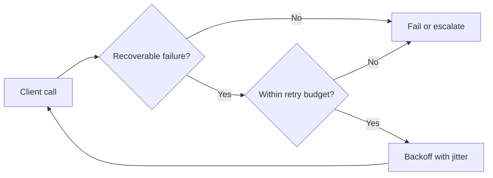

# Visual Storyboard — Fillable Template

**Instruction:** Duplicate for each article. A good figure must do explanatory work. Decide what the reader needs to understand **before** deciding whether to draw boxes, arrows, a chart or a timeline.

- Article ID / version:
- Core thesis:
- Intended reader:
- Medium display constraints: narrow mobile width; clear labels and readable caption.

## Figure inventory

| Figure | Reader question resolved | Explanatory purpose | Figure type | Related claim IDs | Editorial status |
|---|---|---|---|---|---|
| F1 | ... | ... | ... | ... | `IDEA` |
| F2 | ... | ... | ... | ... | `IDEA` |

No predetermined figure quota. Remove any proposed figure that adds no understanding.

## Figure F1 — Specification (copy this block for each figure)

**Working name:** ________

**Placement:** [After which claim, before which complex explanation?]

**Reader question:** ________?

**One-sentence insight:** After viewing, the reader should understand that ________.

**Figure type:** `Conceptual model | Architecture | Sequence | Data flow | Failure path | Comparison | Experiment/chart | Decision flow`

**Representation choice and rationale:** [Why this form rather than prose or a table?]

**Required entities / variables:**
- ...

**Required relationships, direction, order or formula:**
- ...

**Boundaries and assumptions:**
- ...

**Facts driving this visual:** [Claim IDs + sources + applicable versions]

**Exclude:** [Decorative symbols, unsupported metrics, irrelevant subsystems, false implication of exactness]

**Draft figure source:** [Mermaid / SVG source file / code / original drawing file / clear description]

**Proposed caption:** [Say what the figure establishes, including an important caveat if necessary.]

**Proposed alt text:** [Describe the meaningful relationships for a screen reader; do not just repeat the title.]

**Source/rights:** `Original | Adapted with attribution | Licensed third-party`; record URL and permission status where relevant.

**Verification checklist:**
- [ ] Every arrow means something defined; no misleading direction or sequencing.
- [ ] Terms and components match the actual implementation/model/version.
- [ ] Numerical plots represent measured or clearly labeled synthetic data, with appropriate axes/units/baselines.
- [ ] Caption communicates the insight and limitations.
- [ ] The figure is readable on a phone; no microscopic text or overloaded boxes.
- [ ] Information is not encoded by color alone; alt text provided.
- [ ] Source and permissions are resolved.

**Decision:** `KEEP | REVISE | CUT` — reason: ________

## Figure design heuristics

- **Before code:** a conceptual/architecture figure can orient a reader, but do not add one if code itself is the simplest explanation.
- **Mechanisms:** sequence/data-flow diagrams should show exactly where inputs move, state changes, boundaries are crossed and errors appear.
- **Trade-offs:** a comparison chart should name real axes and avoid invented precision. If the relationship cannot be quantified, use labeled qualitative regions with explicit assumptions.
- **Experimental evidence:** include methods or environment in the caption or adjacent text; show baselines and uncertainty where available; do not cherry-pick one outcome.
- **Complex figures:** split by questions, not by arbitrary node count. Prefer one main visual per causal step over a huge diagram meant to cover the entire article.

## Figure-to-prose integration check

For each figure, the paragraph **before** should establish why the question matters. The paragraph **after** should extract the conclusion or introduce the edge case. Avoid “Figure 2 illustrates the architecture” as the entire explanation.

## Optional Mermaid scratch example (illustrative only)

This is only a decision *sketch*, not a correct universal retry implementation; a real design also needs idempotency, deadline, overload signals and per-layer policy. Never reuse the sketch without checking the actual article's scope.
