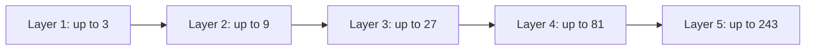

# Worked Example — Applying the Editorial Kit to a Non-AI Topic

> **Status: EXAMPLE BRIEF ONLY — not a finished article or an empirical experiment.**
> The purpose is to prove that this editorial system works beyond AI writing. This is a populated example showing what meaningful answers look like before drafting.

## Document control

- Article ID: `EXAMPLE-RETRY-001`
- Working title: **When Retries Make Outages Worse: Designing Retry Policies for Distributed Systems**
- Version: v1.0; source snapshot: 2026-10-15
- Archetype: Architecture decision + mechanism explainer
- Audience: Backend developers, platform engineers and SREs familiar with HTTP/RPCs and microservices
- Status: Editorial brief populated, selected sources checked; no original experiment performed

## A. Editorial decision

**Reader transformation:** Readers can explain when retries improve the probability of request completion, when they amplify load or duplicate side effects, and how to select a retry policy using failure semantics, deadlines, idempotency and workload constraints.

**Central question:** Why can a retry policy designed to improve availability increase the probability or duration of a service outage?

**Proposed thesis:** Retries should be understood as an allocation of additional downstream work under uncertainty; their safety depends on failure classification, retry placement, idempotency, available capacity and bounded time/attempt budgets—not simply whether exponential backoff is enabled.

**Tension:** Retrying a transient failure often succeeds, yet the same behavior can worsen overload or repeat a side-effecting operation whose result was lost in transit. AWS describes the overload amplification problem; Google SRE describes retry control when overloaded; HTTP semantics distinguishes idempotent and non-idempotent operations. [S1, S2, S3]

**Strong counterargument:** Avoiding retries entirely would sacrifice resilience to sporadic network and partial-service failures. The point is *selective, bounded* retrying, not a universal prohibition. [S1]

**Possible falsifier / qualifier:** If a specific low-cost, idempotent workload has strong spare capacity and independent transient failures, aggressive retries might improve availability with acceptable load; conclusions require that workload's measured traffic and error model.

**Unique contribution:** Combine the failure semantics and load-amplification mechanisms with an explicit policy decision model. Include an original *analytical worked example* and (only if run) a reproducible load experiment; distinguish them carefully.

## B. Scope

**In scope:** RPC/HTTP client retries, overload failure, backoff and jitter, attempt budgets and deadlines, multi-layer amplification, idempotent operations and observable retry behavior.

**Out of scope:** Comprehensive consensus algorithms, exactly-once delivery proofs, all messaging systems, detailed service mesh product comparisons, and global optimal retry tuning.

**Assumptions:** The article discusses request/response services. API-specific retry safety depends on actual operation semantics, not merely a transport-level error code. HTTP's method semantics are relevant but not a substitute for application-specific guarantees. [S3]

## C. Breadth / Depth / Height

| Dimension | Questions | Intended treatment |
|---|---|---|
| Breadth | Why retry at all? What alternatives exist? What do service-level budgets and overload handling change? | Compare retry, fail-fast, load shedding, graceful degradation and idempotency techniques. |
| Depth | Where does retry amplification arise? How do jitter, budgets and deadlines alter behavior? | Trace a multi-layer call chain and work through an explicit attempt-count model. |
| Height | What should a team choose for its workload? | Decision model using error classification, safe repetition, load state, retry locus, remaining deadline and observability. |

## D. Proposed argument and section purposes

1. **A request times out—but did the operation fail?** Establish ambiguous outcomes and the danger of assuming transport failure equals absent side effects. [S3]
2. **Why a second attempt can help—or hurt.** Explain transient vs saturation failures and the added load from retries. [S1, S2]
3. **Where extra work multiplies.** Walk through a layered call graph; derive illustrative amplification under explicitly stated assumptions. [S1, S2]
4. **What bounded retries actually require.** Timeouts, deadlines, backoff, jitter, budgets and careful choice of retry layer; distinguish controls addressing load from those addressing semantic safety. [S1, S2, S4]
5. **When to stop trying.** An architecture decision framework, with specific workload assumptions and examples of when to fail fast or degrade. [S2]

These headings are **working concepts**, not mandatory final titles.

## E. Sources and claim plan

| Source ID | Authoritative source | Claim/role | Important limit |
|---|---|---|---|
| S1 | [AWS Builder Center — Timeouts, retries, and backoff with jitter](https://aws.amazon.com/builders-library/timeouts-retries-and-backoff-with-jitter/) | Reported engineering guidance on retry load, jitter, token buckets, idempotency and multi-layer amplification | AWS engineering experience is not an all-workloads theorem |
| S2 | [Google SRE — Handling Overload](https://sre.google/sre-book/handling-overload/) | Explains overload, selective retry and avoiding retry explosions across layers | Google serving-system policies may not transfer unchanged to other stacks |
| S3 | [RFC 9110 §9.2.2 — Idempotent Methods](https://www.rfc-editor.org/rfc/rfc9110.html#section-9.2.2) | Normative HTTP method semantics and conditions under which automatic retry is appropriate | HTTP method semantics do not prove every application implementation is safe |
| S4 | [AWS Well-Architected — Control and limit retry calls](https://docs.aws.amazon.com/wellarchitected/latest/framework/rel_mitigate_interaction_failure_limit_retries.html) | Supporting best-practice guidance on limiting retries | Guidance is not a measured workload-specific policy |

**Source quality constraint:** S1 and S2 are engineering experience and operational guidance; S3 is a formal specification. Do not treat these as equivalent methods of proof.

## F. Worked calculation — explicitly illustrative

Suppose a service call traverses five downstream layers. Under a *deliberately simplified* model in which each layer can make up to three total attempts and each nested attempt triggers its own downstream call, the maximum number of leaf attempts is:

\[
A_{\mathrm{leaf}} = 3^5 = 243.
\]

AWS uses a five-deep example with a 243× amplification to illustrate compounding retry attempts. [S1] This is a possible worst-case amplification model, **not** a measured average, not a general prediction, and not the result of an experiment conducted for this article. A real system's amplification depends on early successes, retry placement, failure propagation, deadlines and client configuration.

**Experimental option (not yet run):** Compare three controlled scenarios under the same load and fault injector: no retry; immediate fixed retries; bounded retries with backoff/jitter. Capture client success rate, total downstream requests, saturation, p95/p99 latency, end-to-end deadline misses and recovery time. Repeat trials and report variance. Do not describe those expected measurements as actual findings until the experiment exists.

## G. Visual storyboard

**F1 — Transient recovery versus overload feedback (conceptual).** Reader question: why is repeating a failed request sometimes helpful and sometimes damaging? A two-path causal comparison: transient failure → next attempt can succeed; overload → extra attempts → more demand → prolonged saturation. Explicitly label that this is a qualitative mechanism, not a time-series measurement.

**F2 — Multi-layer retry multiplication (mathematical example).** Reader question: how can a modest per-layer retry policy explode into large downstream traffic? Five layers, each with up to three total attempts, accumulating possible attempts as 3, 9, 27, 81, 243. Caption must emphasize worst-case assumptions and distinguish attempts from additional *retries*. Cite S1.

**F3 — The retry decision boundary (policy flow).** Reader question: when should a client stop or try again? Show error classification, operation/idempotency semantics, available retry budget, remaining deadline, and overload signals. Do not present a single universal retry algorithm; note workload-specific branch choices and failure behavior.

One candidate Mermaid scratch diagram for F2:

**Caption concept:** Maximum possible downstream attempts under a simplified five-layer, three-attempt-per-layer model. The diagram does **not** show typical measured load or independent retries at all layers as recommended practice.

**Visual review warning:** Verify the diagram does not imply all 243 calls occur in every scenario, and do not use an unlabeled y-axis to suggest an empirical measurement.

## H. Proposed conclusion

A retry is a resource-consumption decision under uncertain failure semantics. A responsible policy should be designed from the workload backward: determine whether the operation is safe to repeat, whether the error is potentially transient, whether the dependency can absorb more work, which layer should retry, and how much time/attempt budget remains. No universal numeric retry count follows from this example.

## I. G1/G2 decisions

- **G1 — PASS (demonstration):** Specific thesis, audience, original synthesis angle, scope, argument and visual plan.
- **G2 — PROVISIONAL:** Source-level central mechanisms are supported by listed primary resources, but a production-ready article would still need precise claim-to-anchor rows, careful treatment of all error classes and potentially an original reproducible experiment if claiming performance effects beyond these sources.
- **G3 — NOT YET:** Mermaid is a draft sketch only; final diagrams, captions and mobile rendering must be verified.

## Why this is better than a generic retry tutorial

The article is driven by one non-obvious engineering tension; the mechanism is testable and mathematically inspectable; source classes are distinguished; the design consequence is constrained rather than absolute; and three visuals each answer a different question. The same construction method transfers to AI evaluation, databases, stream processing, security architectures, compiler optimization and other topics.
