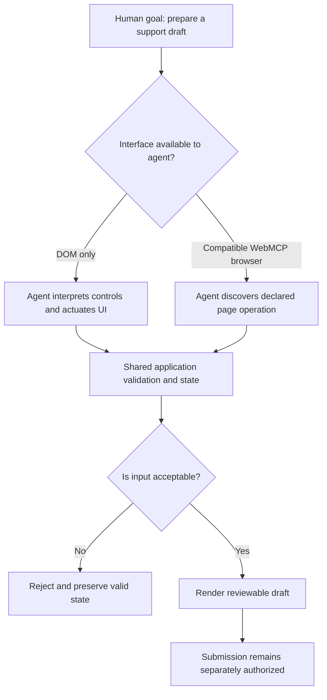

# Worked editorial example: making a WebMCP opening carry the technical story

**Purpose:** Demonstrate a writing decision, **not** claim that this code was executed or a browser agent was observed. API availability and browser flags must be checked against current sources before publishing a real WebMCP article.

## The version that sounds like an abstract

> WebMCP is an emerging protocol for AI agents that allows websites to expose tools. It improves agent interaction through tool discovery and structured calls. Developers can register tools with JavaScript.

The statements are too compressed to teach the architectural shift. The paragraph defines a term without revealing a decision, an execution boundary, or an interesting question. An article cannot earn an 8–10 minute read by repeating this paragraph through multiple section headings.

## A stronger illustrative opening

A support portal has two buttons: **Prepare draft** and **Send request**. A person reading the page understands that one operation creates something to review and the other may contact a server. A browser agent can inspect those labels, fill the fields, and click. But what happens if it interprets “prepare” as confirmation, or if a page update changes which button is available?

The page already knows the distinction. Its business logic decides what counts as a valid draft, when editing invalidates an old review, and which action actually submits data. Traditional browser automation makes an agent recover these rules from the visible interface. WebMCP proposes allowing the page to publish one of those operations explicitly as a callable tool.

That raises a sharper engineering question than “Can an agent click faster?”: **Can the application expose a narrow, inspectable operation while retaining the same validation, visible state, and backend authority that govern a human action?**

## What the body must now deliver

Do not stop at the opening. The manuscript needs a causal passage from DOM actuation to the proposed tool surface, an accurate figure tracing agent -> browser mediation -> page callback -> domain state, a representative structured request and result, a failure path after a user edits the draft, and the security distinction between tool discovery and business authorization. Compare with ordinary backend MCP where relevant. Finally, say exactly which interaction is documented versus which one was actually tested.

The opening is successful **only when the body resolves that architectural question**.

## A compact narrative decision map

*Illustrative conceptual diagram only:* Browser APIs, available capabilities, and the distinction between native invocation and mocks must be verified against the version being discussed.

## The transferable editing lesson

The right kind of length comes from exposing the causal steps that change the reader's judgment. More adjectives, additional headings, and longer recaps do not provide depth. Remove duplicate claims, but keep the **friction, mechanism, concrete state, failure, alternative, and decision** intact.
