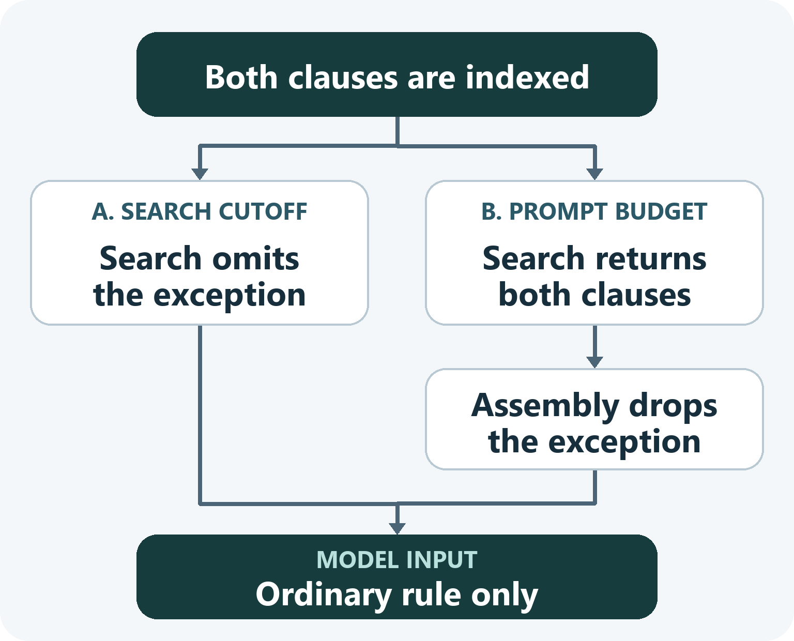

# Why RAG Misses a Policy Exception

*A return request exposes the gap between finding a passage and giving it to the model.*

A customer asks whether they can return an opened air purifier that arrived defective. In this illustrative store policy, ordinary returns require unopened packaging. A separate clause allows defective items to be returned after opening. Both passages are indexed, yet the support assistant replies, “Opened items can’t be returned.”

In retrieval-augmented generation (RAG), an application searches for relevant passages and adds selected text to a language model’s prompt. The store splits its policy into searchable passages, or chunks. That lets the ordinary rule and its exception travel separately. [Anthropic’s RAG primer](https://www.anthropic.com/research/contextual-retrieval#a-primer-on-rag-scaling-to-larger-knowledge-bases)

*The same prompt can result from different decisions. Compare the returned passages with the text sent to the model for the same request.*

## The exception falls below the search cutoff

Suppose search ranks the ordinary rule first and the exception second, with a limit of one result. Turn the question into a retrieval check by marking the defect clause as expected evidence and looking for its passage ID in the returned list.

If similar questions keep pushing it below the cutoff, inspect how the clause is chunked. A passage that starts with “This restriction is waived” may carry little of the policy language a customer uses in a search. Adding the section heading or nearby rule gives the retriever more information about what the waiver applies to. [Anthropic’s analysis of chunks that lose context](https://www.anthropic.com/research/contextual-retrieval#the-context-conundrum-in-traditional-rag)

## The prompt budget drops the exception

Now suppose search returns both passages. The application adds whole passages in rank order, with room for only the first. Raising the search limit leaves that assembly rule in place. If policy exceptions need to travel with the general rule, try packing the clauses together and check whether both fit in the actual prompt. A larger passage can take space from other evidence the answer needs.

## The exception reaches the model

When both clauses are in the prompt and the model still refuses the return, hold the passages fixed and evaluate how the model applies them. Pair the original request with one about an opened air purifier that arrived undamaged. The correct decision changes with a single fact. Score the pair on both the decision and the policy clause that supports it. A model that says yes to both gets one answer right while missing the condition that makes the answers differ.
